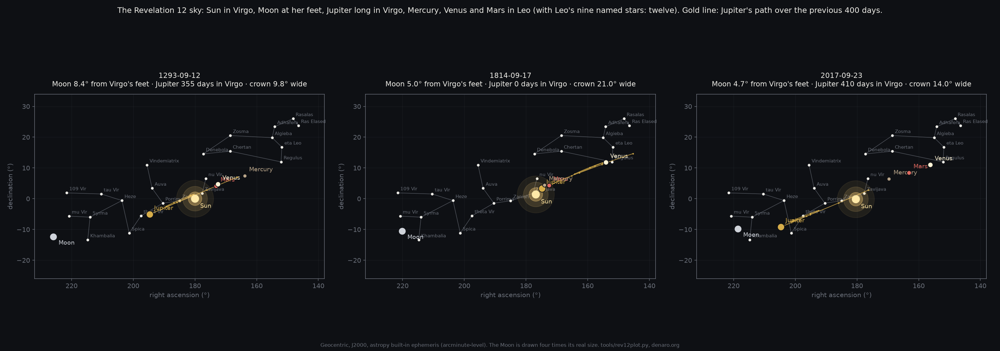
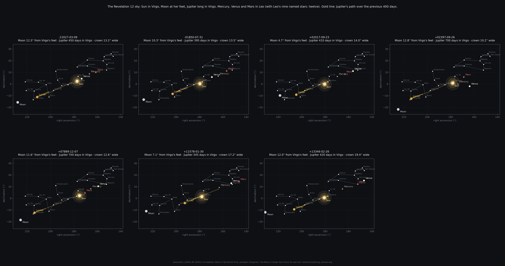

# The Revelation 12 sky, computed

> And there appeared a great wonder in heaven; a woman clothed with the sun, and the moon under her feet, and
> upon her head a crown of twelve stars.
> - Revelation 12:1

The reading of this verse as a picture of the sky on 23 September 2017 is given in the main [README](../README.md):
the Sun in Virgo (clothing her), the Moon at her feet, Jupiter inside her for about a year (the child, with its
retrograde loop), and Mercury, Venus and Mars in Leo above her head, which with Leo's nine named stars make a
crown of twelve. Astronomers answered that the pieces are common: the Sun is in Virgo every September, Jupiter is
in Virgo every twelve years, and the whole pattern "has happened at least four times, in 1827, 1483, 1293, and
1056" (Christopher Graney, Vatican Observatory, on EarthSky, 23 September 2017).

This folder is a check of that answer by computation, done on 8 November 2026: every day from 13,200 BC to AD
17,000 was tested against the whole configuration, and the matches were graded for how well they look like the
2017 sky, with the result that **the 2017 sky is not unique, but it is far rarer than "four times in a thousand
years", and in one respect it stands alone.**

## What was tested

For every day on which the Sun stood inside Virgo (by the IAU constellation boundaries), the positions of the Moon,
Jupiter, Mercury, Venus and Mars were taken from JPL's long planetary ephemeris DE441, which covers 13,200 BC to
AD 17,191 (the longest JPL publishes; before 1000 BC the usual short ephemerides are not trustworthy). Positions are
geocentric, in the fixed ICRS frame, so "which constellation" holds at any epoch. A day has **the ingredients**
when:

- the Sun is in Virgo;
- Jupiter is in Virgo;
- Mercury, Venus and Mars are all in Leo;
- the Moon is within 15 degrees of Virgo's feet (the stars Mu, Iota and Lambda Virginis) and no higher than her
  ankles.

Over 30,000 years, **103 days** have the ingredients. That is already far fewer than the astronomers' loose count
suggests, because Graney's four did not all have Jupiter, and the Moon is at the feet only one or two days a month.

Then each day was graded against 2017 itself, since the claim is not "these things happened" but "it looked like
this":

- **the child:** Jupiter had been in Virgo without a break for at least 270 days (2017: 400-410);
- **a crown of distinct points:** the closest two of Mercury, Venus and Mars at least 5 degrees apart (2017: 6.2)
  and the widest pair within 20 degrees (2017: 13.7);
- **a crown on the Lion, not under it:** the lowest of the three planets at +4 degrees of declination or higher
  (2017: +6.8). IAU Leo reaches south to −6 degrees, well below the Lion's figure, so without this rule a planet
  sitting beside the Sun at Virgo's shoulder counts as "in Leo";
- **the Moon at the feet:** within 13 degrees of the feet stars (2017: 2.5 at midnight, 4.7 at noon; the Moon moves
  13 degrees a day).

## What came out

**Six events in 30,000 years pass the grade:**

| date (TT, proleptic Gregorian) | Moon to feet | Jupiter's days in Virgo | planets: closest / widest | lowest planet |
|---|---|---|---|---|
| 12027 BC, 9 March | 6.9° | 450 | 5.1° / 12.9° | +4.8° |
| 1850 BC, 31 July | 5.8° | 390 | 5.1° / 13.2° | +6.2° |
| **AD 2017, 23 September** | **2.5°** | 400 | 6.2° / 13.7° | +6.8° |
| AD 7889, 7 December | 4.8° | 700 | 6.3° / 12.9° | +4.8° |
| AD 11578, 30 January | 4.0° | 340 | 6.3° / 16.8° | +9.5° |
| AD 13346, 26 February | 5.8° | 420 | 6.3° / 19.7° | +8.0° |

So the configuration at 2017's quality recurs about once in five thousand years: nothing comparable for 3,867
years before 2017, and nothing after it for 5,872 years. (A seventh candidate, AD 2397, has Jupiter and the Moon
in place but Venus and Mercury beside the Sun below the Lion, with Mars in the middle of the crown; it fails the
crown rules.) Of the earlier recurrences the astronomers named, only 1293 even has all the ingredients, and its
crown is bent: Venus and Mars stood 1.1 degrees apart, a single clumped point to the eye, with Mercury 9 degrees
off. 1814 has Jupiter beside the Sun, having just entered Virgo, so no child. 1056, 1483 and 1827 do not have all
the ingredients.

**By eye, fewer still: one.** The six were drawn beside 2017 ([images/](images/)). In 2017 the three planets are
threaded evenly from Regulus down toward Virgo's head, 6 to 7 degrees apart, all inside the Lion. None of the
others keeps that. AD 11578 puts Venus on Regulus and Mars beyond it, outside the crown. AD 13346 puts Mars on
Regulus and Venus outside, with Mercury sagging. AD 7889 drops Mars below the Lion to the Sun's level. 12027 BC is
low at the Lion's rear. 1850 BC is the nearest: Mars crowds Regulus and Venus and Mercury sag toward Virgo's head,
a slumped crown. So by eye a crown as clean as 2017's appears once in 30,000 years, and it is 2017's.

**In one respect 2017 stands alone:** its Moon is the only one squarely under the feet, 2.5 to 4.7 degrees off;
the others sit 4 to 7 degrees off at best, below and east of them.





## What this does and does not show

It removes "unique": the sky repeats, on a scale of thousands of years. It also removes "common": the astronomers'
"four times in a thousand years" counted a looser pattern. What is left is a sky whose ingredients recur about once in five
thousand years by rule, whose nearest neighbour by eye is 1850 BC, and that is not a twin; 2017 is the only one with
a clean crown and the only one in which the Moon is truly at the feet. Whether that is a sign is not a question a computation answers; the computation only says how
rare the picture is.

The thresholds are choices. Set them to 2017's own values and 2017 is unique by construction; loosen them and
2397 or 1293 join the list. The ones used here are stated so that anyone can move them. Other caveats: the IAU
boundaries stand in for the classical figures; "the womb" is approximated by days in Virgo; far from the present
the civil date of a configuration is uncertain by days (Delta T), though the configuration itself is not; the
stars' own motion over ten thousand years shifts the figure by about a degree, which is ignored.

## How to run it

The three scripts are in [tools/](tools/) and need Python with astropy, numpy, matplotlib, skyfield and jplephem.

```
# the long ephemeris, 3.1 GB, from NAIF
curl -O https://naif.jpl.nasa.gov/pub/naif/generic_kernels/spk/planets/de441_part-1.bsp
curl -O https://naif.jpl.nasa.gov/pub/naif/generic_kernels/spk/planets/de441_part-2.bsp

# every day from 13000 BC to AD 17000, graded (about two minutes); the table in scan-13000BC-17000AD.txt
python3 tools/rev12long.py . -13000 17000

# the sky on given dates, side by side (the images in images/)
python3 tools/rev12plot.py --eph . images/rev12-seven-skies.png -12027-03-09 -01850-07-31 +02017-09-23 +02397-09-26 +07889-12-07 +11578-01-30 +13346-02-26

# the first pass, years 1 to 2100 with astropy's built-in ephemeris, no download
python3 tools/rev12.py 1 2100
```

## Provenance

The reading of Revelation 12 as the 2017 sky, the Great Week and the rest of the main README are Jae Kwon's. The
computation here was done at his request by Claude (Anthropic's model, through Claude Code) on 8 November 2026,
while building [denaro.org](https://denaro.org). His prompts, as typed (his keyboard was dropping the letter "a"):

> "the 2017 sky sign recurred four times" --> yeh but did it ever look quite s perfect of  12 pointed crown, tht
> coincides with the 7 dy "gret week" millenil reign of christ seventh dy is the end times now etc etc, not to
> mention jesus rose on the third dy nd it hs been "two dys" now.

> oh come on, 1293 hs venus nd mrs superimposed, tht's  bent crown, does not compre.

> so how unique exctly is 2017? +- 7000 yers? 10000 yers? more? figure it out mke sure the crown shpe 12 pointed
> crown is s good s this one.

> 2397 does not hve  clen crown, mrs is *IN* the middle of the crown.

> 2397 mrs is in the crown, no point showing tht. 13346 mrs is on regulus, nd venus is outside the crown circle,
> this is poor. sme with 11578. none of these re worth showing.

The rules above were tightened in response to the second and fourth of these; the fifth is why the main page now
shows only 1850 BC beside 2017 and calls the by-eye count one. The grading is Claude's operationalization of his
eye test, and is open to his revision. The scripts, the table and the images are
exactly what produced the numbers quoted.
